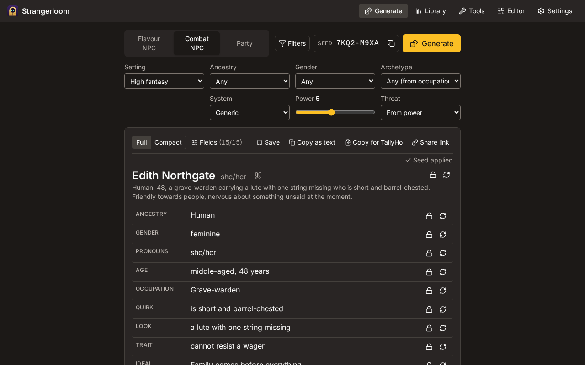
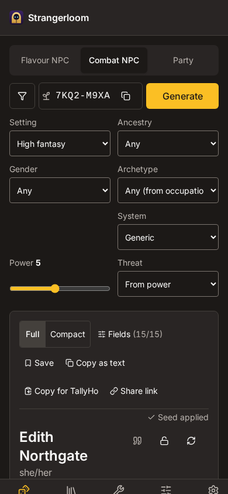

# Strangerloom

Strangerloom is an NPC and party generator for game masters of tabletop role-playing games. One click gives a
flavour NPC (name, look, personality, secret), a combat-ready NPC (an abstract capability profile rendered as a stat
block for the game system of your choice) or a whole adventuring party. Every result is reproducible from a short
seed code and shareable as a link. It runs entirely in the browser: there is no server, no account and no network
request after the page has loaded. It installs as an app and works offline.





## Features

- Three detail tiers: flavour NPC, combat-ready NPC, adventuring party of 3 to 6
- System-agnostic core with adapters that render the same NPC for d20-style, old-school, narrative and stat-light
  systems, or show the abstract profile as is
- Generation from weighted random tables stored as JSON and a seeded random number generator
- Seeds, share links, per-field lock and reroll; a one-line blurb under every name ("Human, 48, a grave-warden
  carrying a lute with one string missing who is short and barrel-chested. Friendly towards people, nervous about
  something unsaid at the moment.")
- Setting presets (high fantasy, grimdark, sci-fi, modern) and filters for tone, ancestry and archetype
- Dice roller for every roll string, hit point and condition tracker, party initiative
- Saved library with favourites, session roster, tags, search and a dated chronicle per record; export as JSON,
  Markdown or print
- Editable table packs and adapter packs
- Fourteen themes or "Match system": light (Light, Paper, Parchment, Sepia, Frost, Lilac, High contrast) and dark
  (Dark, Graphite, Midnight, Candlelight, Horror, Cyberpunk, Terminal)
- Keyboard shortcuts
- A Fields menu on the result card that hides narrative fields; Settings for the default stat block view (full or
  compact) and for switching off the tracker, the roll buttons, the shortcuts or the initiative roller

## Usage

### Keyboard

`G` generates, `R` rerolls the field whose lock or reroll button has focus, `L` locks or unlocks it, `S` saves,
`Enter` or `Space` rolls a focused dice string. The keys are off while you type in a field, and can be switched off
in Settings.

### Save, export and back up

The bookmark button (or `S`) saves the shown NPC or party on the device, in the browser's IndexedDB. The Library
lists saved NPCs, parties and the session roster, with search, favourites and tags. A saved record opens read-only
and can go back into the generator, be copied as Markdown, be saved as a Markdown or JSON file, or be printed.
Besides free notes, every saved record has a chronicle: dated entries with a label such as "Session 4", folded away
until you open it, found by the library search and included in exports and prints.

"Copy for TallyHo" puts an NPC on the clipboard as plain text for the TallyHo app: the person first, one labelled
line per field, then the stat block of a combat NPC after a blank line, which TallyHo's "Paste stat block" reads.

"Export backup" writes the whole library to one JSON file; "Import" reads a backup, one exported record or a list of
records and never overwrites what is already there. Nothing leaves the browser unless you export it.

### Customise the tables and systems

The Editor changes what the generator draws from and how stat blocks come out, without touching the built-in
content. Under Tables, pick a setting and a table: "Customise" copies it into your own pack so your entries replace
the default ones, "Add entries" adds to the default instead; entries have a value, a weight, a condition and tags,
or can be edited as JSON. Under Adapters, "Customise" opens a built-in system as JSON, checks it as you type and
previews a sample NPC; saving keeps your copy under the same id, "Duplicate" makes a new system from it. Under Packs
you can switch your packs off and on, export one as a file or all of them at once, import a pack file or a backup,
and revert everything to the defaults. Revert on a table, an adapter or a pack removes your copy and brings the
built-in one back. Your packs also travel in the library backup. The Filters button next to the seed (only its
icon on narrow screens) narrows tone, ancestries and archetypes for the next rolls.

### Inside another page

Another page can show the app in a frame; the origins in `FRAME_ANCESTORS` (see Configuration) decide which pages
may. Inside a frame the app follows the embedding page's theme once that page sends one. Settings then lists "Follow
TallyHo" as the first theme choice, on by default; picking any other theme stops following and keeps your pick,
picking "Follow TallyHo" again goes back to the embedding page's theme. Following never changes the theme the app
keeps for itself. In a tab of its own the app ignores all of this.

An embedding page sets the theme in two ways, both with one of the theme ids `light`, `paper`, `parchment`,
`sepia`, `frost`, `lilac`, `contrast`, `dark`, `graphite`, `midnight`, `candlelight`, `horror`, `cyberpunk`,
`terminal`:

- the query parameter `embed-theme=<id>` in the address it loads, applied before the first paint and kept for the
  rest of the browser tab's life;
- the message `{ type: 'embed-theme', theme: '<id>' }`, posted to the frame with `postMessage` on every load of the
  frame and whenever its theme changes. Only messages from the frame's parent window count; anything else is
  ignored.

## Run it

### Docker

The image builds the app, runs lint, type checks and unit tests, and serves `dist/` with nginx on port 8080. A
health check answers on `/healthz`.

```sh
docker build -t strangerloom .
docker run --rm -p 8080:8080 strangerloom
```

The app is then on `http://localhost:8080`.

With Docker Compose, `compose.yml` builds the image and publishes it on `HOST_PORT`. Copy `.env.example` to `.env`
to change the defaults:

```sh
cp .env.example .env
docker compose up -d --build
```

A compose file for a host behind a reverse proxy, with placeholders:

```yaml
services:
  web:
    build:
      context: .
    image: strangerloom:latest
    restart: unless-stopped
    environment:
      FRAME_ANCESTORS: 'https://<your-other-app>.example.com'
    ports:
      - '<host-port>:8080'
```

Point the reverse proxy or a Cloudflare tunnel at `http://<docker-host>:<host-port>`, or at
`http://<service-name>:8080` when the proxy shares a Docker network with the service.

### GitHub Pages

1. Fork the repository.
2. In the fork's settings, under Pages, set the source to GitHub Actions.
3. Push to `main`. The workflow in `.github/workflows/pages.yml` runs lint, type checks and unit tests, builds the
   app with the repository name as base path and deploys it.

### From source

Requires Node.js 24 or newer.

```sh
npm ci
npm run build      # static files in dist/
npm run preview    # serve dist/ with the service worker on http://localhost:4173
```

`dist/` can be served by any static web server, under the path set by `VITE_BASE_PATH`.

## Configuration

| Name | Where | Default | Meaning |
|---|---|---|---|
| `VITE_BASE_PATH` | Build (`npm run build`, Docker build argument) | `/` | Path the app is served under, with a leading and a trailing slash, e.g. `/strangerloom/`. Sets asset URLs, the web manifest `id`, `scope` and `start_url`, and the service worker's fallback |
| `FRAME_ANCESTORS` | Container (nginx) | `'none'` | Origins allowed to show the app inside a frame, space separated. Sent as `Content-Security-Policy: frame-ancestors`. `'none'` allows no frame |
| `HOST_PORT` | `compose.yml` | `8080` | Port published on the Docker host |

## Development

```sh
npm ci
npm run dev                        # dev server on http://localhost:5173, without the service worker
npm run lint                       # eslint and prettier --check
npm run format                     # prettier --write
npm run typecheck                  # svelte-check and tsc
npm run test                       # unit tests (Vitest)
npm run test:watch                 # unit tests in watch mode
npx playwright install chromium    # once, for the end-to-end tests
npm run test:e2e                   # end-to-end tests (Playwright) against the preview build
npm run check                      # lint, typecheck, unit tests and build
npm run icons                      # favicons and PWA icons from assets/*.svg (needs rsvg-convert and magick)
```

## Tech stack

TypeScript, Svelte 5, Vite, Tailwind CSS 4, Dexie (IndexedDB), zod, vite-plugin-pwa, Vitest and Playwright; nginx
for the Docker image.

## Licence

MIT. See `LICENSE`.

The app bundles the fonts Inter, Cinzel and Orbitron (SIL Open Font License 1.1) and Special Elite (Apache License
2.0), served by the app itself.

The built-in tables name a few spells, features and items as comparisons ("heavy damage, like a fireball"). This work
includes material taken from the System Reference Document 5.2.1 ("SRD 5.2.1") by Wizards of the Coast LLC, available
at https://www.dndbeyond.com/srd. The SRD 5.2.1 is licensed under the Creative Commons Attribution 4.0 International
License, available at https://creativecommons.org/licenses/by/4.0/legalcode.
